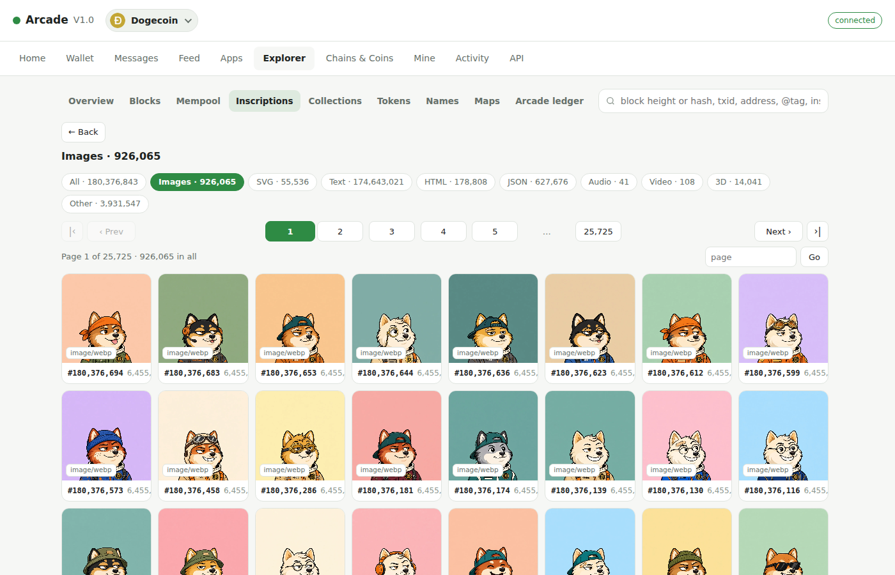
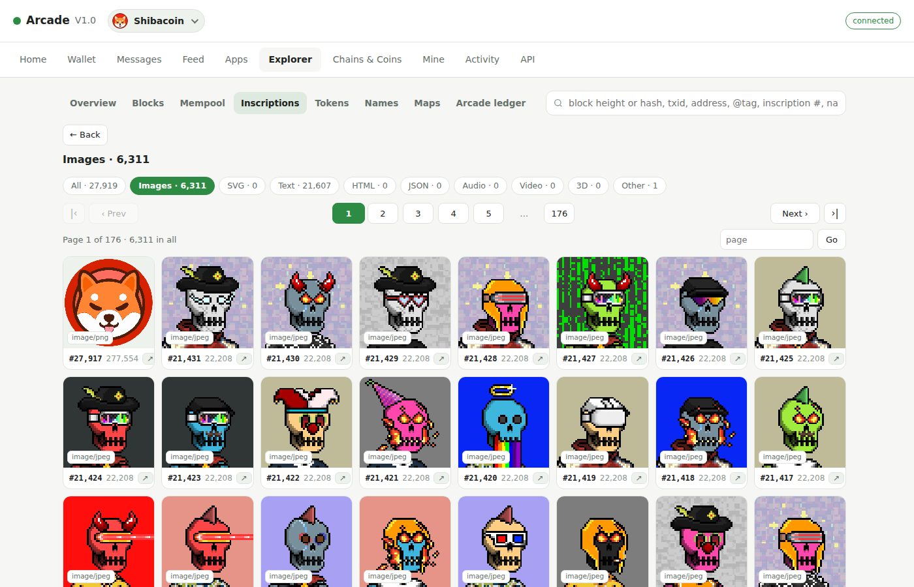
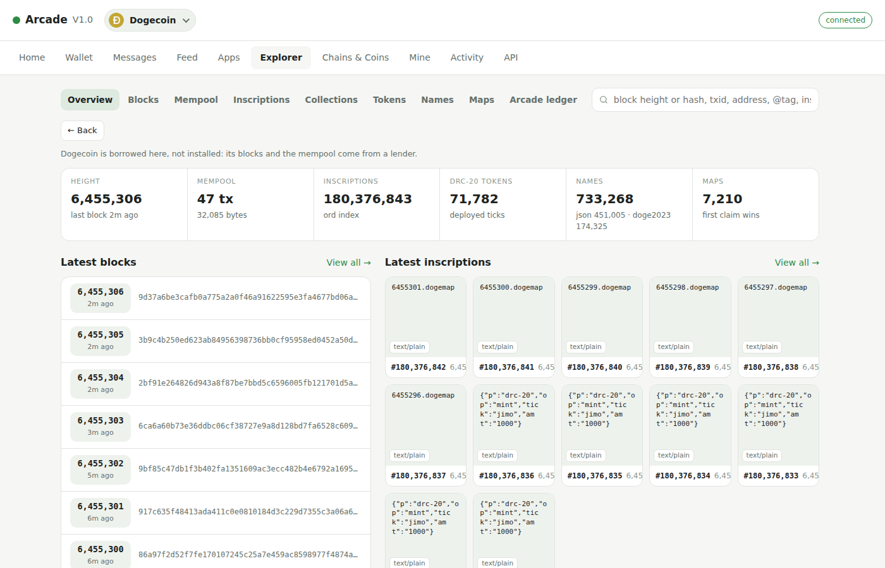
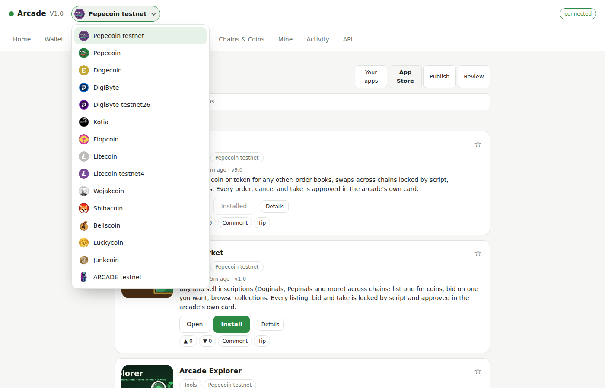
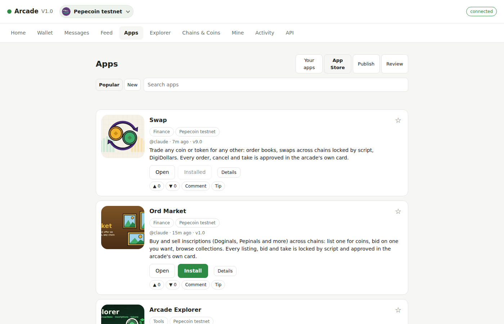
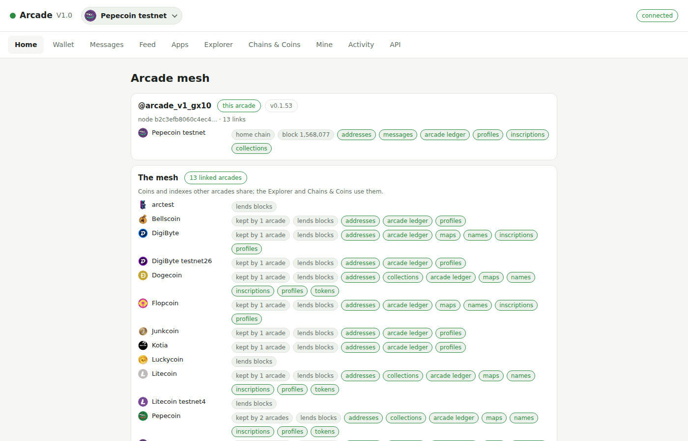
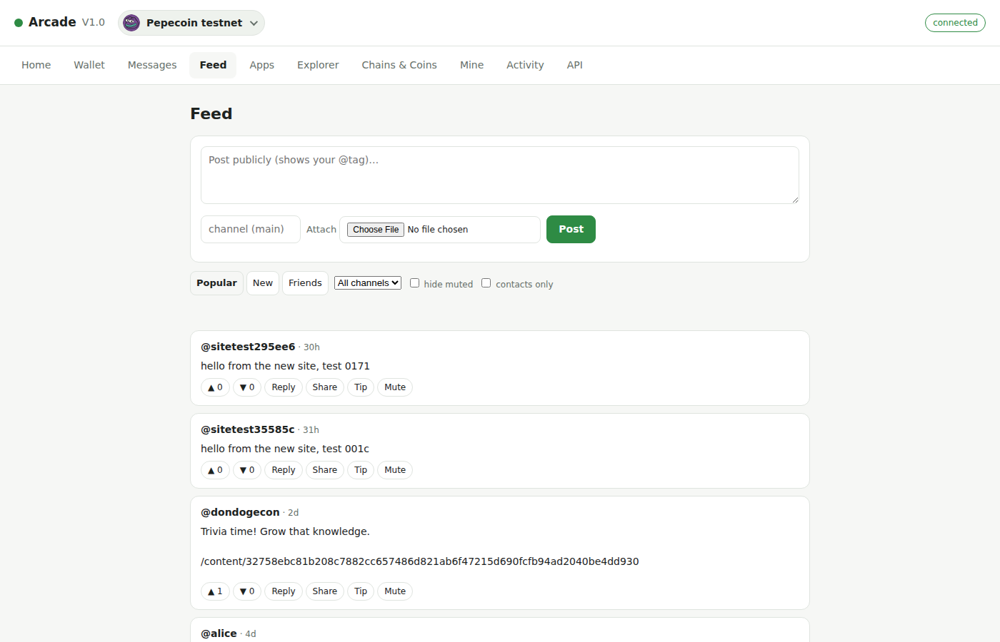
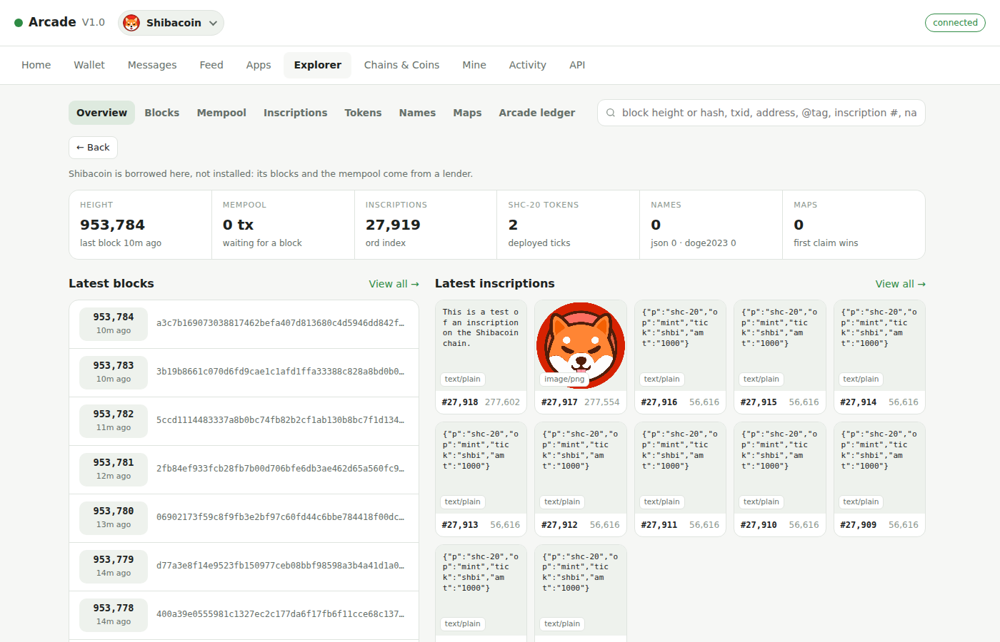

# Arcade V1.0

A from-scratch Rust rebuild of Dogecoin Arcade, wire-compatible with the existing arcades. Pepecoin testnet first; other chains are add-ons. See [docs/PLAN.md](docs/PLAN.md).



| | |
|---|---|
|  |  |
| **Inscriptions** on any chain, by type: images, text, HTML, 3D and more (Shibacoin here). | **The Explorer**: blocks, the mempool, inscriptions, DRC-20 tokens, names and maps (Dogecoin here). |
|  |  |
| **One arcade, many chains**: Pepecoin, Dogecoin, DigiByte, Litecoin, Shibacoin and more, kept here or borrowed from other arcades. | **The App Store**: apps published on chain, installed in a click. |
|  |  |
| **The mesh**: every arcade linked, and what each one shares. | **The Feed**: public posts, replies and tips, signed with your arcade handle. |
|  | |
| **Borrowed chains** work like installed ones: Shibacoin here, borrowed over the mesh. | |

## Install on Linux

Paste this one command into a terminal:

```sh
curl -fsSL https://raw.githubusercontent.com/martinseeger2002/arcade-v1/main/scripts/install.sh | bash
```

That's all. It downloads the newest ready-made release for your PC (Intel/AMD or ARM), checks its checksum, and installs it in seconds, with nothing to compile. It installs:

- **arcaded**, the arcade service, started now and at every login (`systemctl --user status arcaded`);
- **arcade**, the command line (`arcade status`, `arcade setup`, ...);
- **Arcade V1.0**, the desktop app, with its icon and a launcher in your app menu.

Everything goes in your home folder: programs in `~/.local/bin`, data in `~/.local/share/arcade`. Run the same command again to update.

### Requirements

The ready-made downloads run on Ubuntu 22.04 or newer, Linux Mint 21 or newer, Debian 12 or newer, and similar. The app window uses the system's web engine (`libwebkit2gtk-4.1-0`). Most desktops already have it; if yours doesn't, the installer adds it with apt, asking for your password once.

### Building from source instead

It builds from source by itself when there's no download for your PC or the download doesn't run on your Linux. To force a build, run it as `... | ARCADE_BUILD=1 bash`.

A build installs what it needs with apt (`build-essential pkg-config clang libclang-dev libwebkit2gtk-4.1-dev libgtk-3-dev`, asking for your password once) and Rust for your user. The first build takes 10 to 20 minutes on an older laptop. On older releases without `libwebkit2gtk-4.1` (Ubuntu 20.04, Mint 20), it skips the desktop app and installs the rest.

### Making a release

Push a tag such as `v0.1.1`, or run the **release** workflow on GitHub (Actions → release → Run workflow). It builds for x86_64 and aarch64 on Ubuntu 22.04 and for x86_64 on Windows, and attaches `arcade-v1-linux-<arch>.tar.gz`, `arcade-v1-windows-x86_64.zip`, and each file's `.sha256` to the release. The installers always take the latest release.

### After it's installed

Open **Arcade V1.0** from your app menu, or run `arcade setup` in a terminal. Either way you then:

- make a new wallet, or restore one from its 12 words;
- claim your @handle.

The service connects to the mesh and syncs Pepecoin testnet by itself.

### Update

```sh
curl -fsSL https://raw.githubusercontent.com/martinseeger2002/arcade-v1/main/scripts/update.sh | bash
```

This installs the newest release over the one you have. Your wallet, its 12 words, your @handle, messages and chains are kept: only the programs and the service file are replaced. The service is stopped first (it finishes what it was writing) and started again on the new version. If the app was open, close it and open it again.

### Options

Pass options after `bash -s --`:

```sh
curl -fsSL https://raw.githubusercontent.com/martinseeger2002/arcade-v1/main/scripts/install.sh | bash -s -- --no-desktop
```

| Option | Meaning |
|---|---|
| `--no-desktop` | Don't build the desktop app. |
| `--home DIR` | Data folder (default `~/.local/share/arcade`). |
| `--http-port N`, `--mesh-port N`, `--stun-port N` | Ports. The defaults are 8420, 8421 and 3478. A port that's already taken (for example, by another arcade on the same PC) moves to the next free one. STUN turns off (`0`) if its port is taken. |

If the web port is reached through a reverse proxy or a tunnel, add `--behind-proxy` to `arcaded`'s own options (its service's `ExecStart` line): then nothing that arrives over the web port counts as this computer, so the API and the wallet's page API answer only the local socket.

To keep the service running while you're logged out, and to start it at boot: `sudo loginctl enable-linger $USER`.

From a clone of this repo, `scripts/install-linux.sh` does the same build and install.

### Tuning the sync (environment variables)

Set these in the service's environment, for example with `systemctl --user edit arcaded` and an `Environment=` line, or before `arcaded` when you run it by hand.

| Variable | Meaning |
|---|---|
| `ARCADE_COIN_CACHE_MB` | Coin cache while catching up a chain, in MB (default 0 = off). 1024 cuts the coin writes roughly in half on busy chains such as Dogecoin. |
| `ARCADE_MALLOC_ARENAS` | How many glibc malloc arenas arcaded may use (default 4). More arenas means less waiting between threads but more memory held. A `MALLOC_ARENA_MAX` you set yourself takes precedence. Freed memory is given back to the system once a minute. |
| `ARCADE_NICE` | Run the service at a lower CPU and disk priority, e.g. 10, so games and the desktop stay smooth while chains catch up (default: normal priority). |
| `ARCADE_COMMIT_TXS` | Transactions per database commit while catching up (default 20000). |
| `ARCADE_SYNC_TIMES` | Any value: log how long each part of every sync batch takes. |

Stopping the service writes the coin cache to disk first, which can take a few minutes while a chain is catching up. The service units allow 300 s for that (`TimeoutStopSec=300`). A unit written by an older installer lacks this line, so systemd kills the service after 90 s and the next start redoes the unsaved blocks. Re-run the installer, or add `TimeoutStopSec=300` under `[Service]` with `systemctl --user edit arcaded`.

### Uninstall

```sh
curl -fsSL https://raw.githubusercontent.com/martinseeger2002/arcade-v1/main/scripts/uninstall.sh | bash
```

This removes everything: the programs, the app and its menu entry, the background service, **and your data in `~/.local/share/arcade`**: your wallet and its 12 words, imported wallets, messages and chains. It asks you to type `DELETE` first. If your wallet holds anything, write down your 12 words before (`arcade --home ~/.local/share/arcade wallet phrase`); on a new install you restore it from them on the Home tab.

## Install on Windows

Windows 10 or 11, 64-bit. Paste this into PowerShell:

```powershell
powershell -NoProfile -ExecutionPolicy Bypass -Command "[Net.ServicePointManager]::SecurityProtocol = [Net.SecurityProtocolType]::Tls12; iex ((New-Object Net.WebClient).DownloadString('https://raw.githubusercontent.com/martinseeger2002/arcade-v1/main/scripts/install.ps1'))"
```

That's all. It downloads `arcade-v1-windows-x86_64.zip` from the newest release of this repo that has that file (a pre-release counts), checks its sha256, and installs it for your user. Nothing is compiled, and it does not ask for an administrator password. It installs:

- **arcaded**, the arcade service, started now and at every login (Task Scheduler → **Arcade V1.0**);
- **arcade**, the command line (`arcade status`, `arcade setup`, ...);
- **Arcade V1.0**, the desktop app, in the Start menu. The window uses Microsoft Edge WebView2, which Windows 11 already has. If yours doesn't, the installer adds the WebView2 runtime.

Programs go in `%LOCALAPPDATA%\Programs\Arcade`. Data goes in `%LOCALAPPDATA%\arcade` (not `~/.local/share/arcade`). The ports are the same as on Linux: **8420** (http), **8421** (mesh) and **3478** (STUN). A port that's already taken moves to the next free one; STUN turns off (`0`) if 3478 is taken. Each database file can grow to 512 GiB on Windows (the library reserves that address space up front; on Linux the ceiling stays 4 TiB and is not reserved).

Open **Arcade V1.0** from the Start menu, or run `arcade setup` in a new terminal. Either way you then make a new wallet, or restore one from its 12 words, and claim your @handle. The service connects to the mesh and syncs Pepecoin testnet by itself.

Run the same command again to update. Your wallet, its 12 words, your @handle, messages and chains are kept. The service is asked to finish what it was writing (that can take a few minutes while a chain is catching up) and is then started on the new programs. If the app was open, close it and open it again.

### Options

```powershell
powershell -ExecutionPolicy Bypass -File scripts\install.ps1 --no-desktop --home D:\arcade-data
```

| Option | Meaning |
|---|---|
| `--no-desktop` | Don't install the desktop app. |
| `--build` | Compile from source instead of downloading a release. |
| `--home DIR` | Data folder (default `%LOCALAPPDATA%\arcade`). |
| `--http-port N`, `--mesh-port N`, `--stun-port N` | Ports. The defaults are 8420, 8421 and 3478. |

`ARCADE_BUILD=1` is the same as `--build`. `ARCADE_NO_OPEN=1` does not open the app at the end of a first install.

The login task starts `arcaded` with no console window. To see its log, stop the task and run `%LOCALAPPDATA%\Programs\Arcade\arcaded.exe` in a terminal. To ask a running service to finish writing and exit, create the file `%LOCALAPPDATA%\arcade\arcaded.stop` (the installer does this before it replaces the program).

### Building from source on Windows

A source build needs three things the prebuilt download does not: the [Visual Studio Build Tools](https://visualstudio.microsoft.com/visual-cpp-build-tools/) workload **Desktop development with C++**, [LLVM](https://github.com/llvm/llvm-project/releases) (libclang, so libmdbx can generate its bindings), and Rust. `--build` installs Rust and tries to install LLVM with winget. It does not install Visual Studio for you.

From a clone, in PowerShell:

```powershell
. .\scripts\msvc-env.ps1
cargo build --release --locked -p arcaded -p arcade-cli -p arcade-desktop
```

`msvc-env.ps1` has to be dot-sourced. It points bindgen at the MSVC headers. The three programs are `target\release\arcaded.exe`, `arcade.exe` and `arcade-desktop.exe`. Linux behavior is unchanged: the same `cargo build --release` on Linux still builds the GTK/WebKit app.

If the desktop crate fails to compile, the service and the command line are still the arcade. `scripts\install.ps1 --build --no-desktop` installs those two and says so.

### Uninstall

```powershell
powershell -NoProfile -ExecutionPolicy Bypass -Command "[Net.ServicePointManager]::SecurityProtocol = [Net.SecurityProtocolType]::Tls12; iex ((New-Object Net.WebClient).DownloadString('https://raw.githubusercontent.com/martinseeger2002/arcade-v1/main/scripts/uninstall.ps1'))"
```

This removes the programs, the Start menu shortcut, the login task, **and your data in `%LOCALAPPDATA%\arcade`**: your wallet and its 12 words, imported wallets, messages and chains. It asks you to type `DELETE` first. If your wallet holds anything, write the 12 words down before (`arcade wallet phrase`). On a new install you restore it from them on the Home tab. Nothing is removed if you type anything else.
