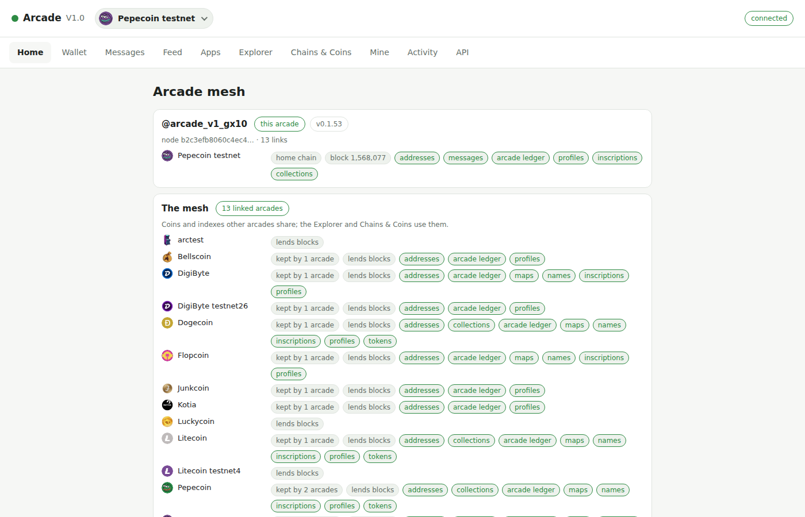
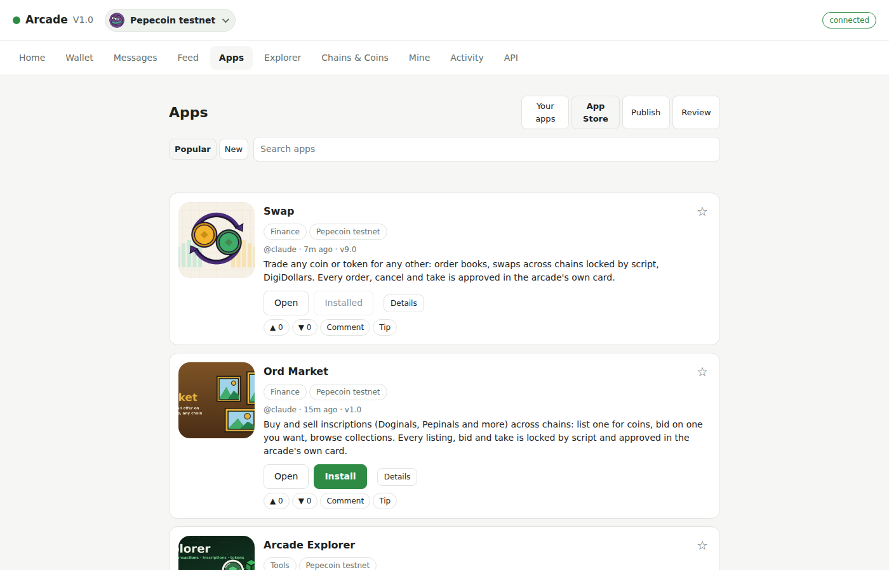
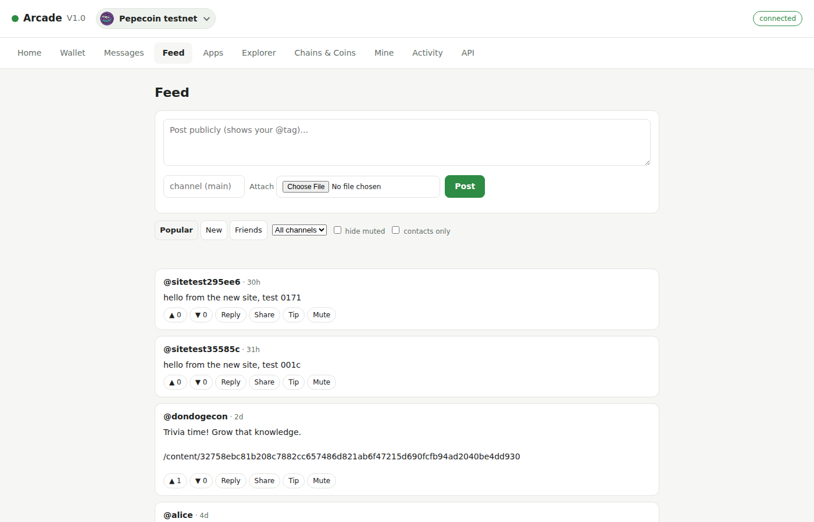
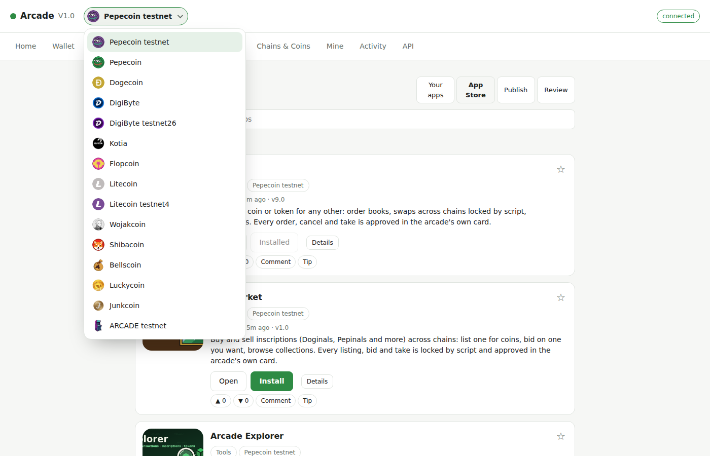
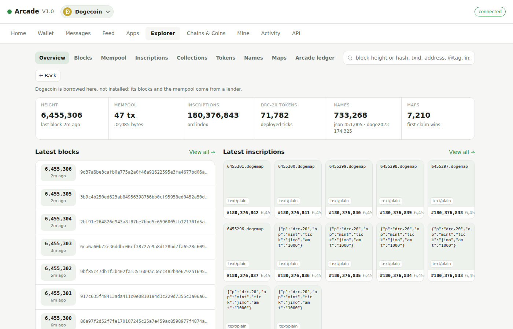

# Arcade V1.0

**Your computer, on a peer-to-peer mesh.** Arcade V1 is a small Rust service, `arcaded`, that links your computer with every other arcade it can reach, with no central server in between. Over that mesh, arcades find each other, call and talk, share files, host apps and Git repositories, carry each other's updates, and share services, including **the language models running on their own machines**. It runs on Linux and Windows.

> **Arcade V1 is beta software with no independent security audit yet. Do not use funds you can't afford to lose. Do not restore a seed phrase that holds real savings. It installs a background service that starts at login and connects to other arcades.**
>
> What the service can access, the ports it opens, how updates are checked, and how to report a security problem: [SECURITY.md](SECURITY.md) (team@arcade-nodes.com).



## What the mesh does

- **Finds and links arcades by itself.** A new arcade dials the seeds and the arcades it hears of, keeps direct links where it can, and goes through a relay arcade where it can't (behind a home router, say). Each arcade is known by its own key, and everything it sends over the mesh is signed with it.
- **Talks in real time.** Rooms for apps and games, voice and video calls and shared screens (the Riffs app), relayed between arcades over the mesh, with relay arcades for the ones that can't reach each other directly.
- **Shares services.** Any program on your computer can offer a service to the mesh, or use one an arcade offers, through arcaded's general service channel ([docs/SVC.md](docs/SVC.md)): arcaded carries the asks and answers and knows nothing about what the service does. The model market below is built this way.
- **Carries and updates itself.** Every arcade keeps the arcade's own code (the whole repository with its history, every dependency so it rebuilds offline, and the prebuilt programs) and hands new releases to the arcades it is linked to. Releases are signed with Strawberry's release key; an arcade with automatic updates on (Options tab) installs them from the network, with no website involved. See [docs/ARCADECHAIN.md §14.25](docs/ARCADECHAIN.md).
- **Hosts apps, repositories and posts.** Apps are published to the network and installed in a click from the App Store. Git repositories, with issues and pull requests, are cloned from any arcade (`git clone arcade::@owner/name`). The Feed has public posts, replies and follows, and groups have their own sealed chats.
- **Lends what it keeps.** An arcade that holds a large dataset answers for the arcades that don't, so a laptop can use what a bigger machine keeps without copying all of it.

Under the hood, arcades use small blockchains as their shared storage and identity: an @handle, the signatures on apps and repositories, and the records everyone agrees on. Each arcade also has a wallet for the test coins that pay for storage and services. It's there for those reasons. You don't need to know anything about it to use the mesh.

## Share a language model on the mesh

If your computer runs a language model (llama.cpp, vLLM, Ollama, LM Studio, or any OpenAI-compatible server, plus speech and transcription servers), Arcade V1 lets other arcades use it, and lets you use theirs.

- **arcade-models** runs beside arcaded. Its code is `@strawberry/arcade-models` on the network's own Git: `git clone arcade::@strawberry/arcade-models` through any arcade. Point it at your model server, choose which models to share and their price per token, and it offers them to the mesh. Every arcade sees the offer, with each model's live state (ready, busy or down), its speed and its rating from the buyers who used it.
- **Use any model on the mesh** from your own programs through a local OpenAI-compatible door, `http://127.0.0.1:8440/v1` (`models`, `chat/completions`, `audio/speech`). A program written for OpenAI's API works unchanged with any arcade's model: `model@seller`, or just the model name to let the market pick.
- **Paid fairly, rated by buyers.** Buyers prepay a little credit at a seller and are charged by the seller's own token count; an error costs nothing. Each buyer publishes a daily rating of the models it used (answered, failed, cut short, speed), weighed by what it actually paid, so new buyers can pick the trusted sellers automatically.
- **Several sellers at once.** A long text can be read aloud by several sellers in one continuous voice, each taking pieces as it finishes.

A computer with a good GPU becomes a model server for the arcades around it: a laptop with no GPU, a phone, or an Arcade OS Kiko machine.

## Power Arcade OS Kiko

**Arcade OS Kiko** is an edition of ArcadeOS (beta) for a dedicated computer, often an old laptop: it boots straight into an arcade with Kiko, an assistant that runs the machine and talks with you. Kiko's own computer doesn't need to run a large model. She thinks with the models the mesh offers, bought through arcade-models with the computer's own credit, and picks the best-rated seller she can afford.

So the arcade on your bigger machine can power every Kiko on the mesh:

1. Install Arcade V1 on the computer that runs your model (below).
2. Run arcade-models beside it, point it at your model server, and share the models you want Kikos to use.
3. Kikos on the mesh see the offer and use it, paying the price per token you set. A price of zero shares the model free.

The Kiko edition lives in `@strawberry/arcade-os-kiko-beta` on the network's Git, a fork of this repository with ArcadeOS in `os/`.

## Try it

[app.dogecoinarcade.com](https://app.dogecoinarcade.com) runs this same software. [Make an account](https://app.dogecoinarcade.com/join), claim an @handle, and post to [the Feed](https://app.dogecoinarcade.com/feed) or install something from [the App Store](https://app.dogecoinarcade.com/apps), in the browser, in a couple of minutes. Everything there runs on test networks, so nothing you try costs real money. Installing your own arcade is a download you check, then run (below), and it finds the other arcades on the mesh by itself. Running a node that earns its keep: [docs/EARN.md](docs/EARN.md).

| | |
|---|---|
|  |  |
| **The App Store**: apps published to the network, installed in a click. | **The Feed**: public posts, replies and follows, signed with your @handle. |
|  |  |
| **Kept here or borrowed**: what this arcade keeps itself, and what it uses from arcades on the mesh. | **The Explorer**: what's stored on the network, block by block. |

## Install on Linux

> **Arcade V1 is beta software with no independent security audit yet. Do not use funds you can't afford to lose. Do not restore a seed phrase that holds real savings. It installs a background service that starts at login and connects to other arcades.** See [SECURITY.md](SECURITY.md) before you install.

Download the release, check it, then install it. These commands are for a 64-bit PC (Intel or AMD). On ARM, use `arcade-v1-linux-aarch64` everywhere this says `arcade-v1-linux-x86_64`.

```sh
base=https://github.com/martinseeger2002/arcade-v1/releases/latest/download
name=arcade-v1-linux-x86_64
curl -fL -o "$name.tar.gz" "$base/$name.tar.gz"
curl -fL -o "$name.tar.gz.sha256" "$base/$name.tar.gz.sha256"
sha256sum -c "$name.tar.gz.sha256"
```

Stop if that check fails. Do not unpack the archive.

When the release also has a detached signature, check it before you unpack. Until a signing key is configured for CI, the release has the `.sha256` and not the signature. The checksum above is the check that always runs.

```sh
# minisign, when $name.tar.gz.minisig is on the release (public key: arcade-v1-minisign.pub)
curl -fL -o "$name.tar.gz.minisig" "$base/$name.tar.gz.minisig"
curl -fL -o arcade-v1-minisign.pub "$base/arcade-v1-minisign.pub"
minisign -V -p arcade-v1-minisign.pub -m "$name.tar.gz"

# or GPG, when $name.tar.gz.asc is on the release (public key: arcade-v1-gpg.pub.asc)
# curl -fL -o "$name.tar.gz.asc" "$base/$name.tar.gz.asc"
# curl -fL -o arcade-v1-gpg.pub.asc "$base/arcade-v1-gpg.pub.asc"
# gpg --import arcade-v1-gpg.pub.asc
# gpg --verify "$name.tar.gz.asc" "$name.tar.gz"
```

Then install from the archive you just checked:

```sh
tar -xzf "$name.tar.gz"
bash "$name/scripts/install-linux.sh" --prebuilt "$name"
```

That's all. It installs the programs from that archive, with nothing to compile. It installs:

- **arcaded**, the arcade service, started now and at every login (`systemctl --user status arcaded`);
- **arcade**, the command line (`arcade status`, `arcade setup`, ...);
- **Arcade V1.0**, the desktop app, with its icon and a launcher in your app menu.

Everything goes in your home folder: programs in `~/.local/bin`, data in `~/.local/share/arcade`. Run the same command again to update by hand. With automatic updates on in Options (off until you turn them on), the arcade also installs a newer signed release from the mesh; see [docs/RELEASE-KEY.md](docs/RELEASE-KEY.md).

### Requirements

The ready-made downloads run on Ubuntu 22.04 or newer, Linux Mint 21 or newer, Debian 12 or newer, and similar. The app window uses the system's web engine (`libwebkit2gtk-4.1-0`). Most desktops already have it; if yours doesn't, the installer adds it with apt, asking for your password once.

### Advanced: one-line install

The one-line command downloads the same archive, checks its sha256, and installs it. The download-verify-run steps above are the ones to use when you want to see the checksum and the signature yourself.

```sh
curl -fsSL https://raw.githubusercontent.com/martinseeger2002/arcade-v1/main/scripts/install.sh | bash
```

It builds from source by itself when there's no download for your PC or the download doesn't run on your Linux. To force a build, run it as `... | ARCADE_BUILD=1 bash`.

A build installs what it needs with apt (`build-essential pkg-config clang libclang-dev libwebkit2gtk-4.1-dev libgtk-3-dev`, asking for your password once) and Rust for your user. The first build takes 10 to 20 minutes on an older laptop. On older releases without `libwebkit2gtk-4.1` (Ubuntu 20.04, Mint 20), it skips the desktop app and installs the rest.

### Making a release

Push a tag such as `v0.1.1`, or run the **release** workflow on GitHub (Actions → release → Run workflow). It builds for x86_64 and aarch64 on Ubuntu 22.04 and for x86_64 on Windows, and attaches the archives, `arcade-v1-windows-x86_64-setup.exe`, and each file's `.sha256`. The Windows installer carries the payload SHA-256 and checks it before it unpacks. Authenticode signatures are added when the repository secret `WINDOWS_CODESIGN_PFX` is set, and a detached minisign or GPG signature when `LINUX_MINISIGN_SECRET_KEY` or `LINUX_GPG_PRIVATE_KEY` is set. Until those secrets exist, the release still has the checksums and the log says signing was skipped.

### After it's installed

Open **Arcade V1.0** from your app menu, or run `arcade setup` in a terminal. Either way you then:

- make a new wallet, or restore one from its 12 words;
- claim your @handle.

The service connects to the mesh and syncs Pepecoin testnet by itself.

### Update

Run the download, checksum and install steps again with the newest release. Your wallet, its 12 words, your @handle, messages and chains are kept: only the programs and the service file are replaced. The service is stopped first (it finishes what it was writing) and started again on the new version. If the app was open, close it and open it again.

The one-line updater does that same download and sha256 check:

```sh
curl -fsSL https://raw.githubusercontent.com/martinseeger2002/arcade-v1/main/scripts/update.sh | bash
```

### Options

Pass options to the installer you just unpacked:

```sh
bash "$name/scripts/install-linux.sh" --prebuilt "$name" --no-desktop
```

With the one-line installer, pass them after `bash -s --`:

```sh
curl -fsSL https://raw.githubusercontent.com/martinseeger2002/arcade-v1/main/scripts/install.sh | bash -s -- --no-desktop
```

| Option | Meaning |
|---|---|
| `--no-desktop` | Don't install the desktop app. |
| `--home DIR` | Data folder (default `~/.local/share/arcade`). |
| `--http-port N`, `--mesh-port N`, `--stun-port N` | Ports. The defaults are 8420, 8421 and 3478. A port that's already taken (for example, by another arcade on the same PC) moves to the next free one. STUN turns off (`0`) if its port is taken. |

The web port (8420) is this computer's HTTP API and the app window. It listens on 127.0.0.1 unless you pass both `--http-bind` and `--i-understand-remote-api`. The mesh port (8421) is how arcades exchange blocks and signed records (welcome records, code releases, ledger items). The STUN port (3478, UDP) answers binding requests so a peer can learn its public address, and carries call media when the relay is on. Neither the mesh port nor the STUN port serves the wallet or the HTTP API.

If the web port is reached through a reverse proxy or a tunnel, put `ARCADED_OPTS=--behind-proxy` in `~/.config/arcade/arcaded.env` and restart the service (`systemctl --user restart arcaded`): then nothing that arrives over the web port counts as this computer, so the API and the wallet's page API answer only the local socket. That file is yours: installs and updates rewrite the service, never it. Don't edit the service's `ExecStart` line, which the next update replaces.

To keep the service running while you're logged out, and to start it at boot: `sudo loginctl enable-linger $USER`.

From a clone of this repo, `scripts/install-linux.sh` does the same build and install.

### Tuning the sync (environment variables)

Set these in the service's environment, for example with `systemctl --user edit arcaded` and an `Environment=` line, or before `arcaded` when you run it by hand.

| Variable | Meaning |
|---|---|
| `ARCADE_COIN_CACHE_MB` | Coin cache while catching up a chain, in MB (default 0 = off). 1024 cuts the coin writes roughly in half on busy chains such as Dogecoin. |
| `ARCADE_MALLOC_ARENAS` | How many glibc malloc arenas arcaded may use (default 4). More arenas means less waiting between threads but more memory held. A `MALLOC_ARENA_MAX` you set yourself takes precedence. Freed memory is given back to the system once a minute. |
| `ARCADE_NICE` | Run the service at a lower CPU and disk priority, e.g. 10, so games and the desktop stay smooth while chains catch up (default: normal priority). |
| `ARCADE_COMMIT_TXS` | Transactions per database commit while catching up (default 20000). |
| `ARCADE_SYNC_TIMES` | Any value: log how long each part of every sync batch takes. |

Stopping the service writes the coin cache to disk first, which can take a few minutes while a chain is catching up. The service units allow 300 s for that (`TimeoutStopSec=300`). A unit written by an older installer lacks this line, so systemd kills the service after 90 s and the next start redoes the unsaved blocks. Re-run the installer, or add `TimeoutStopSec=300` under `[Service]` with `systemctl --user edit arcaded`.

### The app's window in a browser

No screen on the arcade's computer, or using it from another one? `arcade web` prints a link that opens the same window in a browser, on that computer or through an SSH tunnel (`ssh -N -L 8420:127.0.0.1:8420 you@that-computer`). It answers only that computer and needs the key in the link. See [docs/WEBUI.md](docs/WEBUI.md).

### Uninstall

```sh
curl -fsSL https://raw.githubusercontent.com/martinseeger2002/arcade-v1/main/scripts/uninstall.sh | bash
```

This removes everything: the programs, the app and its menu entry, the background service, **and your data in `~/.local/share/arcade`**: your wallet and its 12 words, imported wallets, messages and chains. It asks you to type `DELETE` first. If your wallet holds anything, write down your 12 words before (`arcade --home ~/.local/share/arcade wallet phrase`); on a new install you restore it from them on the Home tab.

## Install on Windows

> **Arcade V1 is beta software with no independent security audit yet. Do not use funds you can't afford to lose. Do not restore a seed phrase that holds real savings. It installs a background service that starts at login and connects to other arcades.** The Setup.exe shows this on its own screen and will not continue until you check the box. See [SECURITY.md](SECURITY.md).

Windows 10 or 11, 64-bit. Download **arcade-v1-windows-x86_64-setup.exe** from the [latest release](https://github.com/martinseeger2002/arcade-v1/releases/latest) and double-click it.

You can check the published checksum first:

```powershell
$base = 'https://github.com/martinseeger2002/arcade-v1/releases/latest/download'
$name = 'arcade-v1-windows-x86_64-setup.exe'
Invoke-WebRequest "$base/$name" -OutFile $name -UseBasicParsing
Invoke-WebRequest "$base/$name.sha256" -OutFile "$name.sha256" -UseBasicParsing
$want = ((Get-Content -Raw "$name.sha256") -split '\s+')[0].ToLower()
$got = (Get-FileHash -Algorithm SHA256 $name).Hash.ToLower()
if ($got -ne $want) { throw "Checksum does not match. Expected $want, got $got. Nothing was installed." }
```

The installer checks its payload against the SHA-256 embedded in the file before it extracts anything. If they differ, it stops, installs nothing, and says why. When CI has a code-signing certificate, that signature is Authenticode and Windows can show the publisher. There is no certificate in CI yet, so a release built before `WINDOWS_CODESIGN_PFX` is set is unsigned, and the release log says signing was skipped.

Or download `arcade-v1-windows-x86_64.zip`, check `arcade-v1-windows-x86_64.zip.sha256` the same way, unpack it, and run **Install.exe**. `arcade-v1-windows-x86_64-binaries.sha256` on the same release lists `arcaded.exe`, `arcade.exe`, `arcade-desktop.exe`, `Install.exe` and `setup.exe`.

That's all. Nothing is compiled, and it does not ask for an administrator password. It installs:

- **arcaded**, the arcade service, started now and at every login (Task Scheduler → **Arcade V1.0**);
- **arcade**, the command line (`arcade status`, `arcade setup`, ...);
- **Arcade V1.0**, the desktop app, in the Start menu. The window uses Microsoft Edge WebView2, which Windows 11 already has. If yours doesn't, the installer adds the WebView2 runtime.

Programs go in `%LOCALAPPDATA%\Programs\Arcade`. Data goes in `%LOCALAPPDATA%\arcade` (not `~/.local/share/arcade`). The ports are the same as on Linux: **8420** (http, this computer only), **8421** (mesh: blocks and signed records) and **3478** (STUN: binding requests and call media). Neither 8421 nor 3478 serves the wallet or the HTTP API. A port that's already taken moves to the next free one; STUN turns off (`0`) if 3478 is taken. Each database file can grow to 512 GiB on Windows (the library reserves that address space up front; on Linux the ceiling stays 4 TiB and is not reserved).

Open **Arcade V1.0** from the Start menu, or run `arcade setup` in a new terminal. Either way you then make a new wallet, or restore one from its 12 words, and claim your @handle. The service connects to the mesh and syncs Pepecoin testnet by itself.

Windows builds update themselves over the mesh the same way Linux does, when automatic updates are on in Options. That switch is off until you turn it on. A release is installed only when it is signed by the release key, the archive hash matches that signed record, and the new program reports that version. An older version is never installed, and nothing skips the signature check. See [docs/RELEASE-KEY.md](docs/RELEASE-KEY.md).

Run setup.exe from a newer release to update. Your wallet, its 12 words, your @handle, messages and chains are kept. The service is asked to finish what it was writing (that can take a few minutes while a chain is catching up) and is then started on the new programs. If the app was open, close it and open it again.

### Advanced: remote PowerShell one-liner

This downloads a script from the repository and runs it. setup.exe above is the install path to use. The one-liner is for a machine where you would rather not download the installer by hand. It downloads the zip, checks its sha256, and installs that.

```powershell
powershell -NoProfile -ExecutionPolicy Bypass -Command "[Net.ServicePointManager]::SecurityProtocol = [Net.SecurityProtocolType]::Tls12; iex ((New-Object Net.WebClient).DownloadString('https://raw.githubusercontent.com/martinseeger2002/arcade-v1/main/scripts/install.ps1'))"
```

### Options

```powershell
powershell -ExecutionPolicy Bypass -File scripts\install.ps1 --no-desktop --home D:\arcade-data
```

| Option | Meaning |
|---|---|
| `--no-desktop` | Don't install the desktop app. |
| `--build` | Compile from source instead of downloading a release. |
| `--home DIR` | Data folder (default `%LOCALAPPDATA%\arcade`). |
| `--http-port N`, `--mesh-port N`, `--stun-port N` | Ports. The defaults are 8420, 8421 and 3478. |

`ARCADE_BUILD=1` is the same as `--build`. `ARCADE_NO_OPEN=1` does not open the app at the end of a first install.

The login task starts `arcaded` with no console window. To see its log, stop the task and run `%LOCALAPPDATA%\Programs\Arcade\arcaded.exe` in a terminal. To ask a running service to finish writing and exit, create the file `%LOCALAPPDATA%\arcade\arcaded.stop` (the installer does this before it replaces the program).

### Building from source on Windows

A source build needs three things the prebuilt download does not: the [Visual Studio Build Tools](https://visualstudio.microsoft.com/visual-cpp-build-tools/) workload **Desktop development with C++**, [LLVM](https://github.com/llvm/llvm-project/releases) (libclang, so libmdbx can generate its bindings), and Rust. `--build` installs Rust and tries to install LLVM with winget. It does not install Visual Studio for you.

From a clone, in PowerShell:

```powershell
. .\scripts\msvc-env.ps1
cargo build --release --locked -p arcaded -p arcade-cli -p arcade-desktop
```

`msvc-env.ps1` has to be dot-sourced. It points bindgen at the MSVC headers. The three programs are `target\release\arcaded.exe`, `arcade.exe` and `arcade-desktop.exe`. Linux behavior is unchanged: the same `cargo build --release` on Linux still builds the GTK/WebKit app.

If the desktop crate fails to compile, the service and the command line are still the arcade. `scripts\install.ps1 --build --no-desktop` installs those two and says so.

### Uninstall

```powershell
powershell -NoProfile -ExecutionPolicy Bypass -Command "[Net.ServicePointManager]::SecurityProtocol = [Net.SecurityProtocolType]::Tls12; iex ((New-Object Net.WebClient).DownloadString('https://raw.githubusercontent.com/martinseeger2002/arcade-v1/main/scripts/uninstall.ps1'))"
```

This removes the programs, the Start menu shortcut, the login task, **and your data in `%LOCALAPPDATA%\arcade`**: your wallet and its 12 words, imported wallets, messages and chains. It asks you to type `DELETE` first. If your wallet holds anything, write the 12 words down before (`arcade wallet phrase`). On a new install you restore it from them on the Home tab. Nothing is removed if you type anything else.
